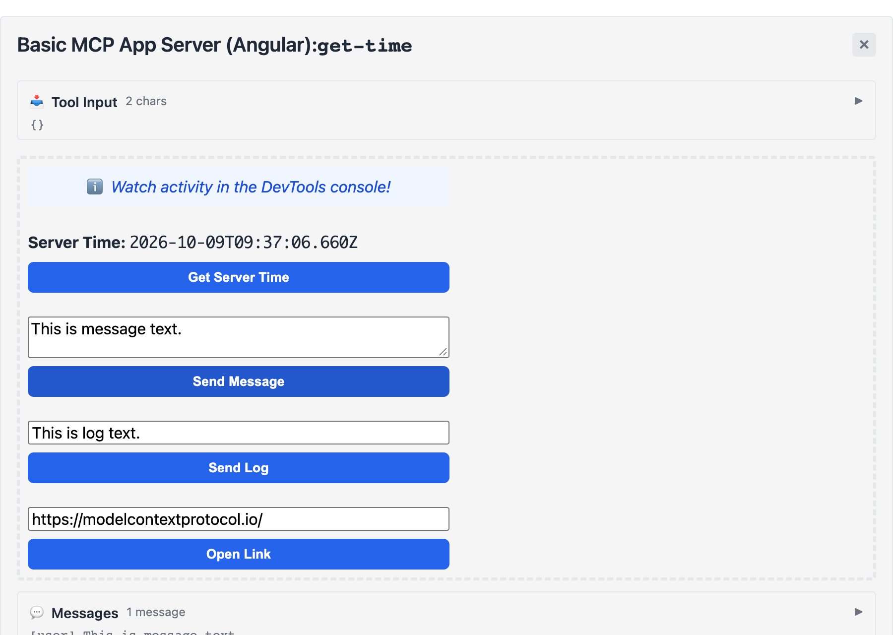

# MCP App starter: Angular

A minimal [MCP App](https://github.com/modelcontextprotocol/ext-apps) with an
Angular UI, built with the **plain Angular CLI** — no Vite, no Analog, no
custom builder. It mirrors the official `basic-server-*` examples
(`basic-server-vue`, `basic-server-react`, …): one `get-time` tool whose UI
calls the server, sends a message and a log to the host, opens a link and
follows the host's theme.



## The problem it solves

An MCP host renders a `ui://` resource as **one HTML document**, usually in a
sandboxed iframe via `srcdoc`. The page cannot fetch the `main-*.js` and
`styles-*.css` that `ng build` writes next to `index.html`, so they 404. The
official examples solve this with `vite-plugin-singlefile`, but the Angular CLI
has no single-file output and no plugin hook for one
([ext-apps#423](https://github.com/modelcontextprotocol/ext-apps/issues/423)).

[`scripts/build-view.mjs`](scripts/build-view.mjs) runs after `ng build`:

1. esbuild folds Angular's chunks (including lazy ones) back into one ES module;
2. the module and the stylesheets are inlined into `index.html`;
3. the build fails if any `<script src>` or `<link href>` still points at a
   local file, so a broken page never ships.

The result is `dist/view/mcp-app.html`, which the server returns from
`resources/read`. Everything else is a normal Angular 22 app: standalone
components, signals, zoneless change detection, AOT, `ng generate` works.

## Getting started

```bash
npm install
npm run build
npm start          # Streamable HTTP on http://localhost:3001/mcp
```

`npm run dev` rebuilds the view on every change (`ng build --watch`, with
inline source maps) and runs the server. The server reads the page on every
request, so reload the app in the host to see a change.

`npm run check` starts the built server over stdio, calls the tool, reads the
UI resource and checks that the page is self-contained. CI runs it on every
push.

### Try it in a host

- **ext-apps reference host** — clone
  [modelcontextprotocol/ext-apps](https://github.com/modelcontextprotocol/ext-apps),
  then `npm install` and `npm start` in `examples/basic-host`, and open
  http://localhost:8080 while this server runs on port 3001.
- **Claude Desktop, VS Code and other stdio clients:**

  ```json
  {
    "mcpServers": {
      "basic-angular": {
        "command": "node",
        "args": ["/absolute/path/to/mcp-app-angular-starter/dist/server/index.js", "--stdio"]
      }
    }
  }
  ```

## Key files

- [`server/server.ts`](server/server.ts) — the tool and its UI resource
- [`server/main.ts`](server/main.ts) — Streamable HTTP and stdio transports
- [`src/app/app.ts`](src/app/app.ts) — the Angular component using the
  [`App`](https://apps.extensions.modelcontextprotocol.io/api/classes/app.App.html)
  class: `connect`, `callServerTool`, `sendMessage`, `sendLog`, `openLink`, host
  theming and safe-area insets
- [`scripts/build-view.mjs`](scripts/build-view.mjs) — the single-file step

## Things to know

- **Size.** The production page is about 750 kB (about 150 kB gzipped). Most of
  it is the MCP SDK's `zod`, whose locales esbuild — which the Angular CLI
  builds with — cannot tree-shake out; the Vite/Rollup examples drop them. The
  development page is several MB because of its inline source maps.
- **External assets.** Inlining is one option. Alternatively, an MCP App can
  load files from a server you host by declaring them in
  [`_meta.ui.csp.resourceDomains`](https://apps.extensions.modelcontextprotocol.io/api/interfaces/app.McpUiResourceCsp.html#resourcedomains).
- **No `ng serve`.** The app needs a host to connect to, so it is developed
  against a host rather than in a bare browser tab.

## A larger example

[ngx-json-render](https://github.com/shteynu/ngx-json-render) uses the same
build step for an MCP App that renders AI-generated UI with Angular Material
components and runs in Claude and ChatGPT.

## Credits

The server, the UI and the styles follow the `basic-server-vue` example from
[modelcontextprotocol/ext-apps](https://github.com/modelcontextprotocol/ext-apps),
ported to Angular.

## License

[Apache-2.0](LICENSE)
